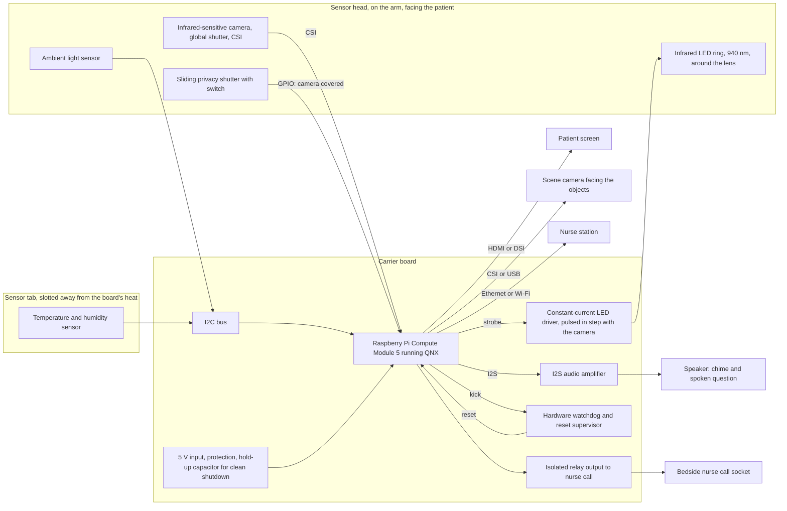

# Prize notes

One section per prize. Each gives the criteria as published, how the project meets them, what has to be true in the demo before we may make the claim, and the one sentence to say to that judge.

State of the project when this was written: the full flow works on a laptop in simulation and with a laptop webcam. Nothing has run on the Raspberry Pi. Gemini is not integrated. The temperature sensor driver has never talked to a real sensor. Each section says what that means for the prize.

---

## 1. Best Use of QNX

**Criteria (verbatim):** "Build an embedded system that uses AI. Your project must run on QNX OS and use at least one open-source AI module from QNX. Judges will look for a use case where real-time performance or reliability matters, a creative use of AI, and a demo running on embedded hardware."

| Criterion | How we meet it | Honest status |
|---|---|---|
| Runs on QNX OS | The app is plain Python with a camera interface that can read frames from a file written by a separate capture process (`--frame-file`), because QNX does not expose the webcam through OpenCV. | **Not yet true.** The capture program is not written and the app has never started on QNX. |
| At least one open-source AI module from QNX | Two candidates: MediaPipe (face landmarks for gaze) and ONNX Runtime (YOLO-World object detection), both installed from QNX's package repository. | **Unconfirmed.** We have not verified that QNX's repository has these packages for our image, or that QNX counts them as its "AI modules". Ask a QNX mentor in the first hour. |
| Real-time performance or reliability matters | A patient who cannot speak or press a button depends on this to call for help. A missed or delayed request is the failure that matters. | True of the use case. |
| Creative use of AI | Two models, both on the device, neither a chatbot: one reads where the eyes are held, the other notices when the object at a spot has changed and changes the question. | True on the laptop. |
| Demo on embedded hardware | Raspberry Pi 5 with the camera, screen and sensor attached. | **Not yet true.** |

**What we can show for "reliability" today (all in the code and tested):**

- Requests are written to disk before they appear on screen, and reloaded as overdue after a restart.
- A supervisor process restarts the app when it exits or when its main loop has published nothing for 5 seconds.
- A stalled camera is treated as "cannot see the patient" after 1 second, never as the last known gaze.
- The device reports its own loop time and frame rate on the nurse station and raises a banner below 5 frames per second.
- Both screens detect a silent device within 3 seconds.
- Object detection runs in its own thread, so a slow scan cannot delay the gaze loop.

**What PLAN.md promised that is not built.** Do not claim these unless someone builds them at the event:

- Separate processes with QNX priorities for alerts, perception and the screen. Today gaze, state machine and alert store share one process and one loop; only the supervisor and the scene detector thread are separate.
- An end-to-end latency readout (frame to question, YES to delivered). Today the nurse page shows only loop time and frame rate.
- A local audible alarm on the device when the network is down. Today the patient screen shows "Nurse station not connected" and the request waits on the device.

If there is time for one QNX-specific addition, make it priorities: run the supervisor and the alert path at a higher priority than perception, and show it with `pidin`. That is the visible use of the operating system the judges are asking for.

**What must be true in the demo for the claim to be honest:**

1. The gaze loop, the question flow and the alert store run on the Pi under QNX. Not on a laptop next to it.
2. At least one model runs on the Pi through a package QNX provides, and a mentor has confirmed it counts.
3. If a laptop is doing any part of the work, we say which part before the judge asks. Two cases are likely: the laptop's camera sends scene photos to the Pi (this is how `scene_sender` works by design; detection still runs on the device), or, as a last resort, the laptop's webcam supplies the face frames because the C270 would not work on QNX.
4. The kill-and-restart step is done on the Pi.

If point 1 is not true by judging time, do not enter this prize.

**Sentence to say:** `[FILL IN after the Pi port. Template: "Everything that decides whether a nurse gets called runs on this Pi under QNX — gaze with QNX's MediaPipe package, object detection with ONNX Runtime — and when I kill it, the watchdog brings it back with the open request still waiting."]` Say only the parts that are true on the day.

---

## 2. Best Health Hack by Sun Life

**Criteria (verbatim):** "Build a creative technical solution to a real health problem. In your pitch, show who it helps and what impact it could have."

| Criterion | How we meet it |
|---|---|
| A real health problem | Awake patients who cannot speak or use their hands cannot ask for basic care. The evidence is published and Canadian in part: a Quebec study of 2,355 charts found three times the odds of a preventable adverse event for patients with communication problems (Bartlett, CMAJ 2008). |
| Creative technical solution | The patient does not operate a device. They look at the real thing they want, and answer one yes/no question. The questions follow the objects and the room temperature. |
| Who it helps | First, ventilated ICU patients: in one study of 2,671, more than half were awake and responsive enough to be served by a communication tool (Happ 2015). Longer term, people with ALS (about 4,000 Canadians, per ALS Canada) and locked-in syndrome. Also the nurse, who arrives knowing what is wanted. |
| What impact it could have | Basic needs met sooner: thirst was the most intense symptom in a study of seriously ill ICU patients and was reported in 7 of 10 symptom checks (Puntillo 2010); more than a third of pain exchanges with nonspeaking ICU patients failed (Happ 2011). Less frustration: 18 of 29 patients interviewed after ventilation described high frustration communicating (Patak 2006). |

**What must be true for the claim to be honest:**

- Say "could". We have no evidence that this device improves any outcome. It has been used only by the team, sitting upright, in good light.
- Use the wording in [pitch-facts.md](pitch-facts.md). In particular, do not say "70% of patients rated thirst their worst symptom" and do not quote a price range for eye-gaze devices.
- Say it is not a medical device and has not been tested with patients, before a judge has to ask.
- Present it as a first layer for basic needs alongside full communication devices, not a replacement for them or for a speech-language pathologist.
- `[FILL IN if it happened: any conversation with a nurse, speech-language pathologist or person with lived experience at the event, with what they said. Even one such conversation is worth more to this judge than another statistic. Do not imply one that did not happen.]`

**Sentence to say:** "More than half of ventilated ICU patients are awake enough to communicate but have no way to ask for water or say they're in pain; this lets them do it by looking at the water and answering yes with their eyes, with a webcam instead of a specialist device."

---

## 3. Best Hardware Prototype by PCBWay

**Criteria (verbatim):** "Build a hardware prototype that solves a real problem. Show how it works and what you'd fabricate for the next version."

| Criterion | How we meet it | Honest status |
|---|---|---|
| A hardware prototype | Raspberry Pi 5, Logitech C270 on top of a screen facing the patient, SHT3x temperature and humidity sensor on I2C, a second camera facing the objects, a lamp. | `[FILL IN: what was physically assembled and working. If the prototype is a laptop with a webcam, this prize is a weak fit; say so to the team and decide.]` |
| Solves a real problem | Same as the health section. | True of the problem. |
| Show how it works | Live demo, plus the block diagram below. | Depends on the weekend. |
| What you'd fabricate next | The design below. | A proposal. Nothing has been laid out or ordered. |

### Why the current prototype is not enough

Four problems we have already met, each of which is a hardware problem:

1. **It needs a lamp.** A webcam cannot read eyes in a dim room, and patients sleep with the lights off.
2. **It is a pile of parts.** A camera on a screen, a sensor on jumper wires and a second camera on a laptop cannot be wiped down or moved with the bed, and calibration breaks when anything shifts.
3. **The temperature sensor sits next to a warm computer.** It will read high unless it is thermally separated.
4. **It talks to a web page.** Hospitals already have a nurse call system with a socket at every bed.

### Next version: one carrier board in a bed-rail enclosure

A carrier board for the Raspberry Pi Compute Module 5 (same processor as the Pi 5, made for custom boards), in a sealed enclosure on a clamp arm.

What goes on the board, and why:

- **Infrared camera with a global shutter, on CSI.** Replaces the USB webcam. Infrared lets it see the eyes in the dark; a global shutter lets the lighting be flashed briefly instead of left on. CSI cameras are also the best-supported camera route on QNX.
- **Infrared LED ring at 940 nm with a constant-current driver.** 940 nm has almost no visible red glow, so it does not disturb sleep. The driver pulses the LEDs only while the sensor is exposing, which keeps the average output and the heat low. Eye safety has to be checked against the lamp safety standard (IEC 62471) before anyone is exposed for hours; we have not done that analysis.
- **Ambient light sensor.** Switches the infrared on only when the room is dark.
- **Temperature and humidity sensor on a thermally separated tab.** A routed slot in the board around the sensor, with the tab placed at an air vent away from the processor. Same I2C sensor family the code already decodes.
- **Audio amplifier and speaker.** The chime and a spoken version of the question, for patients who cannot see the screen well. Today the sound comes from a browser page.
- **Hardware watchdog.** Today a software supervisor restarts the app. A watchdog chip that resets the whole board if the software stops kicking it covers the case where the operating system itself hangs.
- **Isolated relay output on a jack.** A request closes a contact, the same way a hand-held call button does, so the device can trigger the hospital's existing nurse call system. Which connector and wiring a given hospital's system accepts needs checking with its supplier.
- **Hold-up capacitor.** Enough stored energy to finish writing the request file if the plug is pulled.
- **Privacy shutter with a switch.** A physical cover over the lens that staff or family can slide shut, wired so the software knows the camera is covered and says so on the nurse station.

Enclosure and mounting:

- A clamp that fits a hospital bed rail or an IV pole, with a short lockable arm, so the camera moves with the bed and stays at a fixed distance from the face. That directly attacks the calibration-drift problem.
- Smooth, sealed surfaces with no fan and no open vents facing the patient, so it can be wiped with disinfectant. Heat leaves through the back plate.
- One cable.

What we would actually order for version 2: the carrier board (4 layers is enough for this design), a small ring board for the LEDs, and the sensor tab as part of the main board. `[FILL IN if the team wants to quote a cost or board size: get it from PCBWay's calculator; do not guess.]`

**What must be true in the demo for the claim to be honest:**

- There is physical hardware on the table that the judge can see working: at minimum the camera and screen driven by the Pi. `[FILL IN]`
- If the sensor is shown, it is the real sensor being read, not the simulation page's temperature box. The driver is untested; test it before judging.
- The next-version design is described as a proposal. No schematic or layout exists. If someone draws one at the event, bring it. `[FILL IN]`
- No cost claim without a bill of materials.

**Sentence to say:** "This version proves the idea with a webcam and a lamp; the next one is a single board on a bed-rail clamp with an infrared camera and LED ring so it works in the dark, a relay that plugs into the hospital's own nurse call, and a hardware watchdog."

---

## 4. [MLH] Best Use of Gemini API

**Enter only if Gemini is integrated and working at judging time. Today it is not: there is no Gemini code in the repository.**

**Criteria:** `[FILL IN: copy MLH's wording for this prize from the event's Devpost page. We do not have it.]`

**The planned role, stated honestly.** Today the question for each object comes from a hand-written table in `config/zones.json` ("cup" → "Are you thirsty? Do you want a drink?"). The detector can be exported with any word list, but someone has to write a question and a nurse message for every word. Gemini would write those at setup time:

- Input: the object the scene camera detected (or a caregiver's photo of it), plus room context such as temperature and time of day.
- Output: the question to show the patient and the message to send the nurse, in a fixed JSON shape matching the existing table.
- A caregiver sees the suggestion and accepts or edits it before it is used. The question a patient is asked is never unreviewed model output.
- It runs once per object at setup, or when a new object appears. It is **outside the real-time loop**. The gaze loop, confirmation and alerting never wait on the network, and the device works with the network unplugged using the questions it already has.

Why this is a reasonable use and not decoration: it is the step that lets the device handle objects nobody planned for, which a fixed table cannot do.

**What must be true in the demo for the claim to be honest:**

- A judge can watch a new object get its question from a live Gemini call, and see the caregiver accept it.
- We say plainly that Gemini is used at setup only and why (a network call must not sit between a patient and a nurse).
- We do not describe the gaze reading or object detection as Gemini. Those are MediaPipe and YOLO-World on the device.
- No video or image of the patient's face is sent to Gemini. If a photo of an object is sent, say so.

**Sentence to say:** `[FILL IN only if integrated. Template: "Gemini writes the question for any new object at setup — detected object plus room context in, patient question and nurse message out — and a caregiver approves it; it's deliberately kept out of the real-time loop so the device still works with the network unplugged."]`

---

## 5. Overall prizes

**Criteria:** `[FILL IN: Hack Western's overall judging criteria from the event page or opening slides. We do not have the wording, so the points below are organised around what overall judging usually weighs.]`

- **Does it work?** The live demo is the argument. One clean pass of look → question → YES → nurse told → acknowledged is worth more than every extra feature. Rehearse that pass until it is boring.
- **Is the problem real?** Three sourced facts, no more (see [pitch-facts.md](pitch-facts.md)): half of ventilated patients are awake enough to communicate; a third of pain exchanges fail; three times the odds of preventable harm.
- **Is it technically substantial?** Two on-device models, a per-person calibrated classifier with a "none of these" answer, a state machine designed around false alarms, restart recovery, and automated tests. Mention the tests; few hackathon projects have any.
- **Is it original?** The closest prior work either simulated the recognition or used it to speed up typing on a screen. Nothing we found combines looking at real objects, a yes/no confirmation, and delivery to a nurse.
- **Is the team honest about limits?** State the three biggest before being asked: objects must be far apart, it needs light on the face, and it has never been tried with a patient.

**What must be true in the demo:**

- Nothing is presented as working that is not. If a step is shown in simulation mode (buttons on the nurse page standing in for gaze, or a typed temperature), say "this part is simulated" as you do it.
- Any number spoken aloud is either in pitch-facts.md or was measured by the team that weekend.

**Sentence to say:** "People who can't speak or move still look at what they want; we built a device that turns that look into a specific request on a nurse's screen, and it keeps that request safe even if the device crashes."

---

## Quick decision table for the team

| Prize | Enter if | Today |
|---|---|---|
| QNX | The core loop runs on the Pi under QNX with a QNX-provided AI package | Not yet |
| Sun Life Health | Always; the pitch stands on the laptop version | Ready |
| PCBWay Hardware | There is physical hardware working on the table | Depends on the Pi port |
| Gemini | A live Gemini call is part of setup | Not integrated |
| Overall | Always | Ready on laptop |
